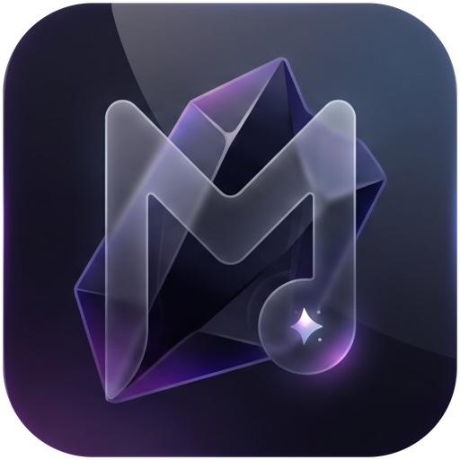

<p align="center"></p>

# Obsidian Music

A simple, beautiful local music player for Android with a glass interface.
It plays the songs already on your phone, newest first, and stays out of your way.

## Features

- **Scans your phone's music automatically** through the system media library (no folder picking).
- **Latest first** by default, so new downloads are always at the top. A glass dropdown switches the list to Favorites, A to Z, Artist, Oldest or Longest.
- **Favorites**: tap the star in the full player (right of the controls) to keep a song in the Favorites view.
- **Shuffle** from the home screen or the player; skips and auto-advance follow the shuffled order.
- **Auto-next**: a song ends, the next one starts. The queue loops at the end.
- **Background playback**, **lockscreen controls**, and a **media notification** (play/pause, next, previous, seek) via a Media3 `MediaSessionService`. Headset and Bluetooth buttons work too.
- **Glass UI** over a dark obsidian base. Glow colours follow the current album art.
- **Fluid motion**: spring press feedback, a mini player that expands into a full player, swipe down to dismiss, breathing artwork, scrubbable seek bar.
- **Light on battery**: one media query on open, no polling in the background, position updates only while a song is playing and the screen is on, and no looping animations except the small equalizer on the playing row.

## Build

Requires JDK 17 and the Android SDK (Android Studio handles both).

```bash
./gradlew assembleDebug      # debug APK
./gradlew assembleRelease    # minified APK, signed with the debug key so it installs directly
```

Output: `app/build/outputs/apk/`.

GitHub Actions builds the release APK on every push to `main` (see the **Actions** tab, artifact `ObsidianMusic-release`). Push a tag like `v1.0.0` and the APK is attached to a GitHub release.

Minimum Android version: 8.0 (API 26). Target: Android 15 (API 35).

## Stack

Kotlin, Jetpack Compose, Material 3 (theme only), AndroidX Media3 (ExoPlayer + MediaSession), AndroidX Palette.

## Project layout

```
app/src/main/java/com/obsidian/music/
  MainActivity.kt          edge-to-edge host
  PlayerViewModel.kt       library state and a MediaController to the service
  data/                    Track model and MediaStore scanner
  playback/PlaybackService.kt   ExoPlayer + MediaSession (notification, lockscreen)
  ui/                      Theme, glass modifier, screens, motion helpers
```

## Permissions

| Permission | Why |
| --- | --- |
| `READ_MEDIA_AUDIO` / `READ_EXTERNAL_STORAGE` (Android 12 and below) | Find your music |
| `POST_NOTIFICATIONS` (Android 13+) | Show the playback notification |
| `FOREGROUND_SERVICE_MEDIA_PLAYBACK` | Keep playing with the screen off |
| `WAKE_LOCK` | Keep the CPU awake only while playing |
